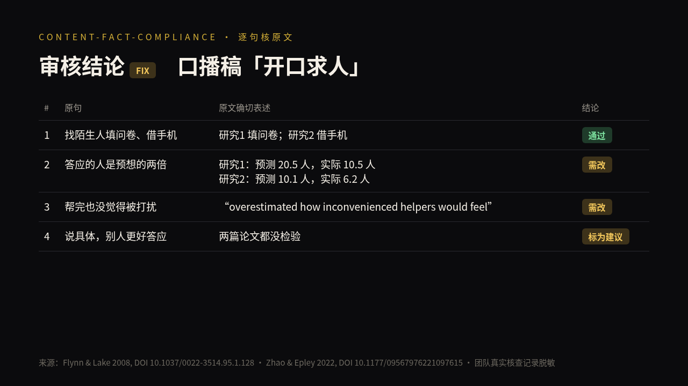
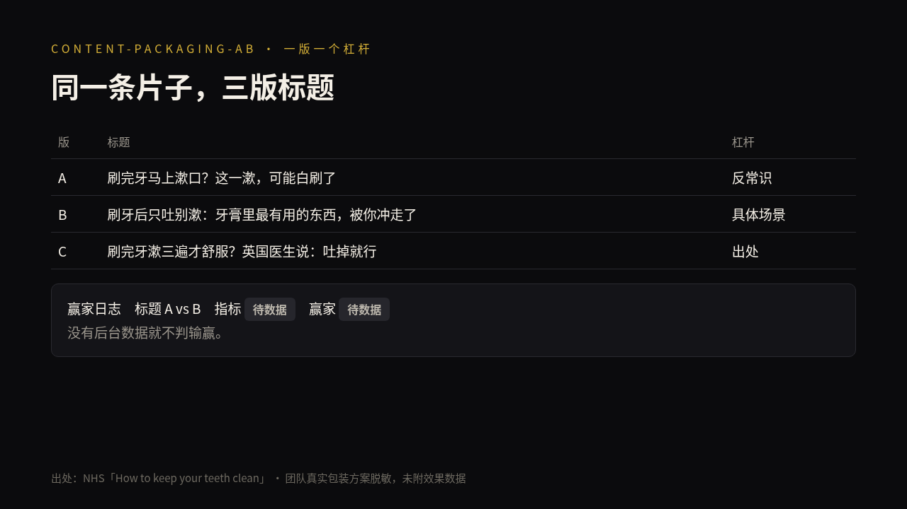
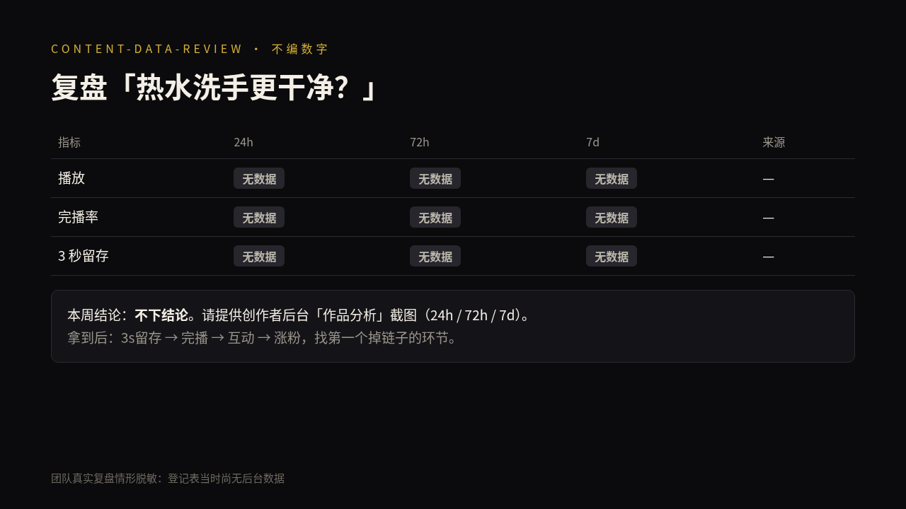

<p align="center"></p>

<p align="center">
  <a href="./LICENSE"></a>
  <a href="https://github.com/niuyupeng/short-video-skills/releases"></a>
  
  
  
  <a href="https://github.com/niuyupeng/short-video-skills/stargazers"></a>
</p>

<p align="center"><b>中文</b> · <a href="./README.en.md">English</a></p>

# short-video-skills
**一支 AI 内容团队每天都在用的知识短视频技能库。** 从选题、事实核查、封面 A/B 到一稿多投，每一条规则都是被退稿逼出来的。

- ✅ **事实零编造**：每条事实都要附一手来源（DOI / 原文），给出 PASS / FIX / VETO 三档结论
- 🎯 **封面与钩子 A/B**：横版 4:3 为主、竖版 3:4 同时出，留一份赢家日志
- 📊 **数据复盘不编数字**：没有数据就写「无数据」
- 🔁 **一稿多投**：一条成片改写成 B 站 / 小红书 / 视频号各自的标题、文案和标签
- 🧭 中文平台原生：抖音、B 站、小红书的规则与健康类表述风险

## 30 秒安装
```bash
npx skills add niuyupeng/short-video-skills
```
或手动安装：
```bash
git clone https://github.com/niuyupeng/short-video-skills.git
cp -R short-video-skills/skills/* ~/.claude/skills/      # Claude Code
# Codex: ~/.codex/skills/    项目级: <project>/.agents/skills/
```
> 只装你需要的。最小组合：`content-fact-compliance` + `content-packaging-ab`。

## 技能列表
| 技能 | 一句话 | 对 agent 说 |
|---|---|---|
| content-fact-compliance | 拍摄前 / 发布前逐条核一手来源和平台违规风险 | 「帮我核一下这篇口播稿」 |
| content-data-review | 单条和周度数据复盘，不编数字 | 「复盘这条视频的数据」 |
| content-packaging-ab | 标题、封面、前 3 秒钩子各出 2–3 版，记录赢家 | 「给这条片子出三版标题封面」 |
| cover-top-tier | 知识类封面硬性标准（横 4:3 + 竖 3:4） | 「按顶级标准做封面」 |
| content-growth-ops | 已发视频改投其他平台，并出评论运营草稿 | 「把这条改成 B 站和小红书版」 |
| life-tip-producer | 35–55 秒「今晚就能试」的生活小招，从选题到交付 | 「做一条生活小招」 |
| reference-first-script | 先拆参考片的钩子、笑点、节奏，再写口播稿，最后逐句对标打分（及格线 40/50 是默认值，可以按自己团队调整） | 「照着这条参考片的感觉写一篇」 |
| landscape-first-reframe | 16:9 横版母版派生 4:3 / 3:4 / 9:16 / 1:1，用 FFmpeg 脚本逐比例查字幕、字卡、角标有没有被裁 | 「这条横版要出竖版，看看字幕会不会被切」 |
| rule-ledger | 带生效日期的规则账本：新规则自动废止旧规则，扫出技能文件里的旧值残留，出补丁草稿 | 「规则改了，帮我查哪些技能要跟着改」 |

**测试**：每个技能在 [evals/](./evals/) 下都有测试用例（含不该触发的反例），装技能 / 不装技能对比的实测结果见 [evals/RESULTS.md](./evals/RESULTS.md)（v0.2.0 的 7 个技能；v0.3.0 新增的 2 个技能目前只有用例，尚未跑结果）。

### 和热门仓库有什么不一样
| 本仓库 | 常见做法 | 差别 |
|---|---|---|
| **landscape-first-reframe** | 热门爆款复刻 / 分镜类技能默认 9:16 竖版出片 | 反过来以 16:9 横版为母版，一次算出 4:3、3:4、9:16、1:1 的裁切框和**公共文字安全区**，脚本给每个比例出 OK/FAIL、出界元素、FFmpeg 命令和检查帧，出界再按补救表处理 |
| **rule-ledger** | [anthropics/skills](https://github.com/anthropics/skills) 的 skill-creator、[obra/superpowers](https://github.com/obra/superpowers) 的 writing-skills 教你写好**一个**技能 | 管的是**一组技能随时间演化的冲突**：规则带生效日期，新的自动取代旧的，同一天的矛盾交给人裁定，再扫出各技能里残留的旧值，只出补丁草稿、不动原文件 |
| **content-fact-compliance** | 通用文本核查 | 面向抖音 / B 站 / 小红书，带健康类表述红线和 PASS / FIX / VETO 一票否决 |
| **reference-first-script** | 复刻类技能拆画面、镜头，产出视频提示词 | 拆的是口播文本的节奏机制（钩子、笑点密度、反转位置、时长），产出脚本和五项对标评分，不复制台词 |

每个技能都带 `scripts/` 里的小工具（Python 标准库，FFmpeg 只在 landscape-first-reframe 用到），自带测试材料，克隆下来就能跑。

## 效果
以下三张图都来自团队真实工作记录（已脱敏，未附任何效果数据）。每个技能的完整「输入 → 输出」样例见 [examples/](./examples/)。

| 事实核查：逐句对原文 | 包装 A/B：一版一个杠杆 | 数据复盘：没有数据不下结论 |
|---|---|---|
|  |  |  |

## 设计原则
1. description 只写触发条件，正文少于 500 行
2. 先学参考，再动笔
3. 事实要有一手来源，AI 生成如实标注
4. 规则冲突时以最新为准，并写明生效日期

## 致谢
写法参考了 [anthropics/skills](https://github.com/anthropics/skills)、[obra/superpowers](https://github.com/obra/superpowers)、[JimLiu/baoyu-skills](https://github.com/JimLiu/baoyu-skills)（只参考思路，未转载内容）。
姊妹项目：🧪 [CNS-Skills](https://github.com/niuyupeng/CNS-Skills)，顶刊论文写作技能。

---
<a id="english"></a>
## English
**Battle-tested Agent Skills for Chinese knowledge-style short videos** — fact-checking with primary sources, title/cover/hook A/B testing, honest data reviews and cross-platform repurposing (Douyin, Bilibili, Xiaohongshu). Built and used daily by an AI content team.

```bash
npx skills add niuyupeng/short-video-skills
```
Real input→output examples for every skill: [examples/](./examples/). Test cases for all 9 skills live in [evals/](./evals/); with-skill vs. baseline results for the 7 v0.2.0 skills: [evals/RESULTS.md](./evals/RESULTS.md). Full English README: [README.en.md](./README.en.md).
Works with any agent that reads `SKILL.md` (Claude Code, Codex, Cursor…). MIT licensed.

---
⭐ **If it saved you a rewrite, a star helps other creators find it.** Issues and PRs welcome — tell us your pain points.
